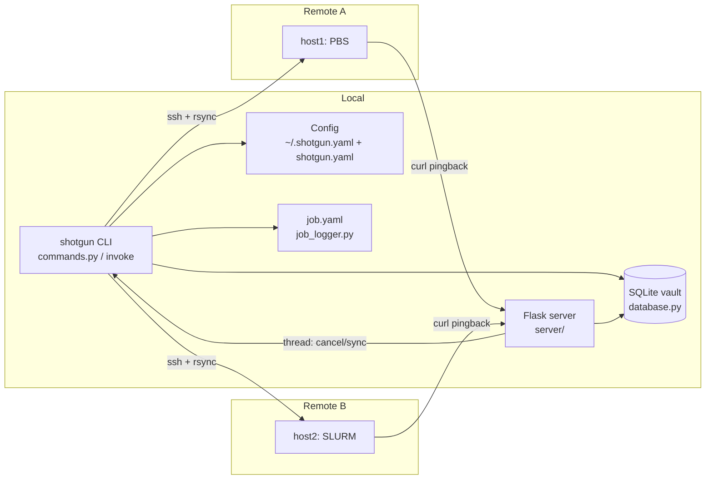

# Shotgun Architecture

This document describes the internal design of Shotgun for agents and
developers making non-trivial changes. See [../AGENTS.md](../AGENTS.md)
for a quick-start summary.

## Purpose

Shotgun submits the same computational job to *multiple* HPC clusters at
once (different schedulers/queues), mirrors the job directory to each
remote, tracks all submissions under one logical job id, and — when the
optional server is running — keeps only the first job that actually starts
running, canceling the rest and syncing results back.

## Component Diagram



## Module Details

### CLI layer — `shotgun/commands.py`

- Built on **invoke**: `program = Program(namespace=ns,
  config_class=ShotgunConfig)`; every `@task` becomes a subcommand.
- `ShotgunConfig` extends `invoke.config.Config` with shotgun defaults and
  prefix `shotgun` (invoke's env-var / config-file machinery applies).
- `load_job_root_config(ctx)` merges the project `shotgun.yaml` into the
  invoke context and normalizes per-target attributes (`host`,
  `asset_dir`, `skip_pingback`, ...). Most commands call it after
  `os.chdir(job_dir)`.
- `submit` registers the job directory in the DB (idempotent per
  directory: re-submitting reactivates the row and resets `started`),
  then loops over configured targets: asset rsync → `generate_util`
  (writes `util.sh` into the job dir) → job-dir rsync → remote submit →
  record result in `job.yaml`.
- `check_this` queries each active target, updates states, optionally
  cancels all-but-the-longest-running and downloads results.
- `check_all` fans out `check_this` over a `ThreadPoolExecutor`
  (`--j` workers, `--retry` re-runs for failures).
- `set_started` / `set_finished` are used both as CLI tasks and as the
  server-side effects of pingbacks; the server wrappers `job_started` /
  `job_ended` run them in background threads with a fresh invoke
  `Context`.

### Configuration — `shotgun/config.py`

- `find_job_root_config()` walks parent directories looking for
  `shotgun.yaml`; raises `FileNotFoundError` at filesystem root. The
  directory containing it is the *job root*; job directories are
  identified by their path relative to it, and the same relative path is
  recreated under each target's remote `job_root`.
- All YAML handled with `ruamel.yaml` round-trip-capable `YAML()`.

### Database — `shotgun/database.py`

- SQLAlchemy declarative model `Job` → table `jobs`:
  `id` (PK), `created_at`, `updated_at` (UTC), `jobdir` (String 512),
  `active` (bool), `started` (bool).
- `JobVault` wraps engine/session creation against `sqlite:///<VAULT>`.
- `session_guard` context manager: commit on success, rollback on error,
  always close.
- `find_jobs` composes filters (`active`, `started`, `project` as
  `jobdir` prefix match, created/updated ranges) and returns
  `JobInstance` namedtuples (detached from the session).
- State transitions (`set_started` / `set_finished`) are driven by
  `job_logger.Job.set_job_state`, not called directly by the CLI.

### Per-job log — `shotgun/job_logger.py`

- `Job` wraps `<job_dir>/job.yaml`: `{jobid, targets: {name: {job_qid,
  state}}}`.
- `ACTIVE_STATE` defines which states count as live: `queued`,
  `dependency_hold`, `user_hold`, `system_hold`, `running`, `suspended`.
- Every state write persists the YAML and reconciles the DB row: ≥1
  running target ⇒ `started=True, active=True`; 0 active targets ⇒
  finished. This makes the DB a queryable index over scattered
  `job.yaml` files.

### Remote execution — `shotgun/remote_agent.py`

- `Connection` is a minimal fabric-style wrapper around the system `ssh`
  binary: `Popen("ssh host 'cmd'")`, stdout/stderr pumped by daemon
  threads into queues so both streams are captured without deadlock;
  result object gets `.ok`, `.stdout`, `.stderr`.
- `RemoteAgent` dynamically imports `shotgun.scheduler.<name>` based on
  the target's `scheduler` attribute and delegates all scheduler-specific
  command building/parsing to it.
- Sync uses `rsync -rltDz --partial` (+ `--delete` / `--delete-excluded`
  on upload); remote dir created via `ssh mkdir -p` first.
- `submit` normalizes resources: `time_in_seconds` → `H:MM`, memory
  strings (`10GB`, `512MB`...) → MB via `convert_size_to_MB`, defaults
  filled from target attributes (`with_submit_defaults`), then splices
  `extra_options` into the command string before ssh execution.
- `command_decorator` target attribute lets a site wrap every remote
  command (string.Template with `$command`).

### Scheduler adapters — `shotgun/scheduler/`

Contract per module (must all exist):

| Function | slurm | pbs | lsf |
|---|---|---|---|
| `submit_command(...)` | `sbatch` | `qsub` | `bsub` |
| `query_command(qid)` | `scontrol show job` | `qstat -f` | `bjobs -UF -X` |
| `cancel_command(qids)` | `scancel` | `qdel` | `bkill` |
| `hold_command(qids)` | `scontrol hold` | `qhold` | `bstop` |
| `release_command(qids)` | `scontrol release` | `qrls` | `bresume` |
| `parse_submit_output(stdout)` → `{job_qid}` | "Submitted batch job N" | `N.host` | `<N>` |
| `parse_query_output(stdout)` → dict keyed by `QUERY_ATTRIBUTES` | `key=value` pairs + state/reason maps | `key = value` lines | `bjobs -UF` text |

Each adapter maps native states to the shared state vocabulary
(`queued`, `running`, ...). SLURM additionally refines `queued` via the
`Reason` field (`Dependency` → `dependency_hold`, etc.).
[../timeout.txt](../timeout.txt) is a captured sample of `scontrol show
job` output used to develop the SLURM parser.

### Pingback server — `shotgun/server/`

- `__init__.py` builds the Flask app at import time, loading `TOKEN` and
  `VAULT` from `~/.shotgun.yaml` (`ServerInitError` if missing).
- Auth: HTTP Basic with fixed username `token` and password = `TOKEN`
  ([basic_auth.py](basic_auth.py)).
- Routes ([responder.py](responder.py)):
  - `GET /<job_id>/<target>/started` → mark target running, cancel other
    active targets, optional sync (background thread).
  - `GET /<job_id>/<target>/ended` → sync results back, mark exited.
  - `GET /<job_id>/should-exit` → `True` if another target already
    started (late starters exit immediately).
  - `GET /<path>` → static file serving from `static/`.
- The client side is the generated `util.sh` (from
  [../shotgun/templates/util.sh](../shotgun/templates/util.sh)): sourced
  by the batch script, it calls `/started` at launch and registers an
  EXIT trap that calls `/ended`. Skipped entirely when the target sets
  `skip_pingback: True`.
- `templates/shotgun.server.plist` is a macOS launchd unit for running
  the server (`flask run --host 0.0.0.0 --port 8080`).

## Data Flows

### Submit

```
shotgun submit --job-script sub.sh
  → load configs (user + job-root)
  → db.add_job(job_dir)            # id → job.yaml
  → for each target:
       rsync assets  (local_asset_dir → asset_dir)
       write util.sh (server URL, token, jobid, target)
       rsync job dir (job_dir → remote job_root/rel_path)
       ssh submit (scheduler submit_command)
       job.yaml[target] = {job_qid, state: queued|submit_failed}
```

### Check / reconcile

```
check_this: for each active target:
    ssh query → parse → update job.yaml state
    (--cancel) keep longest-running, cancel other active targets
    (--sync)   rsync results from the winning target
check_all:  same, threaded across all DB rows with active=True
```

### Pingback (server mode)

```
remote job starts → curl /id/target/started
    → set_started: job.yaml[target]=running, cancel sibling targets
    → siblings poll /id/should-exit and exit, or get canceled
remote job EXIT trap → curl /id/target/ended
    → set_finished: rsync back, job.yaml[target]=exited
```

## Design Constraints & Risks

- **Shared cwd**: tasks `os.chdir` freely; `check_all` threads inherit the
  process-wide cwd, so parallel checks of different job dirs can
  interfere. Any refactor toward true parallelism must remove the
  `chdir` pattern first.
- **Failure handling**: `@failable` converts `invoke.UnexpectedExit` into
  `None` — every caller must null-check; silent failures are by design
  (one unreachable cluster must not break the rest).
- **Security**: ssh/rsync rely on the user's ssh config/agent; the
  pingback token is Basic-auth over HTTP (use a reverse proxy with TLS
  for real deployments).
- **Single-file SQLite vault** shared by CLI and server threads; writes
  are short and guarded, but heavy concurrency is not a design goal.
